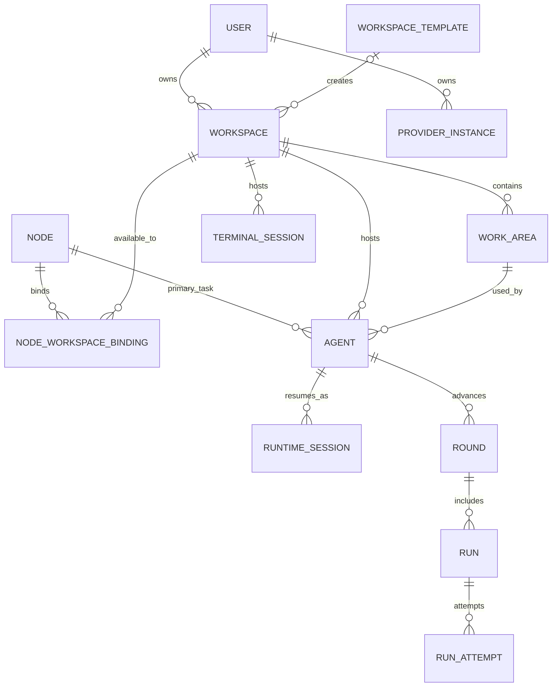
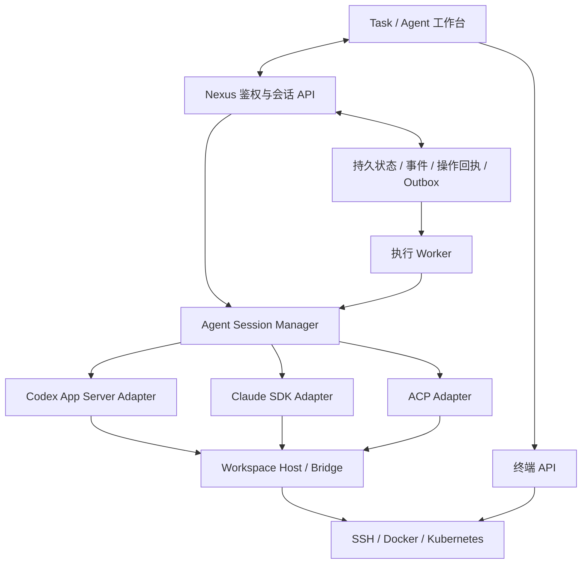

# Nexus Agent 系统设计

更新：2026-11-27。状态：**系统规范；当前实现及产品能力边界见 [实现记录](AGENT_IMPLEMENTATION.md)**。

本文整理多 Harness 接入、Workspace、Task、Agent、终端和可靠执行的统一方案。核心原则来自本轮讨论；字段、接口扩展、默认数值和迁移步骤是据此提出的实现方案，不代表当前线上已经提供。界面及交互以 [Agent UI 设计](../ui-design/AGENT_UI_DESIGN.md) 为准。

现有实现边界见 [Workspace 与 Agent 实现基线](../ui-design/WORKSPACE_AGENT_DESIGN.md)。遇到冲突时，本文决定新架构方向，旧文解释已有行为；不得将旧数据直接按新含义解释或在打开页面时迁移远端资源。

2026-11-27 交互修订：Round 保留为工作记录和 API 兼容模型，不作为用户对话的必经流程。用户直接发消息继续；已结束轮次由下一条消息自动建立后续记录，不自动完成 Task。下一步建议由当前 Agent 生成，界面只填入可编辑草稿，不另设个人模型。澄清问题优先使用 Harness 原生问答协议，无原生工具时使用任务范围 REST 回调；问题及答案按账号、Agent 隔离并持久化。查看终端替换对话主区域，避免上下分屏。后文显式轮次接口作为可选操作保留。

## 1. 产品目标与确定的原则

用户从 Task 创建 Agent 后，可以连续查看对话、工具执行、待回应问题与工作产物，必要时进入同一工作目录操作 CLI；离开页面、切换账号或浏览历史不改变后台工作的生命周期。

| 决策 | 目标行为 |
| --- | --- |
| Agent 的主交互 | 结构化对话，默认不展示终端 TUI |
| tmux | 可恢复终端功能，不再作为新 Agent 的产品模式 |
| 独立 Linux 用户 | Workspace 的执行身份／隔离选项，不与容器后端并列 |
| Workspace | 实际运行环境和持久目录；Template 才是创建配置 |
| Task 与 Workspace | 账号内多对多，支持祖先可用性继承 |
| 默认分配 | 复用合适环境；新的并行代码工作默认使用独立 worktree |
| Agent 与工作目录 | 继续同一 Agent 时保留原目录，不每轮重建 |
| 多 Harness | Codex 原生 App Server、Claude Agent SDK、通用 ACP 适配到统一模型 |
| 工作完成 | 协议 turn 结束、业务 Round 待验收、Task 完成分别记录 |
| 前端框架 | 参考 T3 Code 的交互与分层；CopilotKit／AG-UI 为可选界面适配层 |
| 公网多用户 | Nexus 账号、执行身份、文件、Provider 凭据和事件均需明确隔离 |

首期不建设跨主机自动调度集群、自动 Agent 团队或通用工作流编排器；多 Agent 可以独立服务同一 Task，后续委托以相同会话与权限模型扩展。

## 2. 领域模型与关系

### 2.1 对象定义

| 对象 | 职责与生命周期 |
| --- | --- |
| Connection | 当前账号的 SSH／Kubernetes 访问档案与服务端凭据引用 |
| WorkspaceTemplate | 后端、身份、仓库来源、基准版本、存储、依赖准备和目录策略；不保存 Prompt、tmux 会话或固定工作分支 |
| Workspace | 真实执行实例、创建配置快照、执行身份、资源标识、仓库基础与持久根目录 |
| NodeWorkspaceBinding | 项目根、TODO 或文本节点到 Workspace 的显式关联；可向后代提供可用性 |
| ProviderInstance | 某个 Harness 的安装／桥接版本、账号、模型设置、凭据引用和能力；在目标 Workspace 中解析其可用安装 |
| Agent | 用户可命名的持久工作会话，拥有一个主要 Task、一个 Workspace、一个 WorkArea；对话身份不等于进程 PID |
| WorkArea | Agent 实际工作目录、Git 分支／基准提交、创建归属及共享策略；独立于进程存活 |
| RuntimeSession | 当前原生 Harness 会话、远端进程身份、连接和代次；可退出、重建或从原生历史恢复 |
| Run / RunAttempt | 一次输入触发的执行及其实际尝试；网络重试、进程恢复和新工作不可混为同一次发送 |
| Round | 一个 Agent 的业务推进单元，含目标、预期产物、验收条件，可包含多个 Run |
| Message / ToolCall / Approval | 有稳定 ID 的对话项、工具执行和需用户决定的请求 |
| Artifact / Report | 文件变更、提交、PR、设计和验证结果；报告关联 Round 与正文版本 |
| TerminalSession | Workspace 内的人工终端，可指向某个 WorkArea；关闭面板只解除连接 |

`Task` 在本文也指可以承载 Agent 工作的文本节点；节点类型转换不能丢失关联。项目根可提供配置、Workspace 及背景；从全局创建 Agent 时必须选择主要节点，不制造隐藏的占位 Task。

### 2.2 关系与不变量



- 每个对象有稳定的 Nexus ID 和不可由客户端改写的 `ownerUserId`。原生 ID 只作为带 ProviderInstance、Workspace、会话代次作用域的引用。
- Agent 的主要 Task、Workspace、WorkArea 在创建后固定；跨环境继续通过显式交接创建关联的新 Agent，旧会话保留。切换模型是否可原位完成取决于适配器能力。
- 一个 Agent 同时最多一个活动 Run；新消息排队或按原生能力追加，不能并行对同一会话调用两次执行。
- WorkArea 可被多个 Agent 引用，但默认单写者；并行写代码使用不同 WorkArea。共享目录需要明确选择及控制权协调。
- Workspace 创建来源 `createdFromNodeId` 是溯源，不是删除所有权；归档来源 Task 不销毁 Workspace。
- 当前绑定同一 Workspace 的 Agent 可以使用不同 ProviderInstance；不能因此读取彼此 Provider 凭据。

### 2.3 继承与候选选择

节点可有多个模板和多个 Workspace。模板可用性、Workspace 可用性和本次创建选择是三个不同状态。

候选按当前节点显式关联、最近祖先到远祖先的可继承关联、用户明确展开的账号内其他实例排序，同一 ID 去重并保留来源。跨账号记录永不进入候选；运行后端、仓库、身份、权限及资源状态必须满足本次需求。

推荐顺序：当前明确查看的合适实例 → 当前节点最近成功使用的合适实例 → 最近祖先的合适实例。最近使用按账号和节点记录，不改变父节点或其他 Task 的选择。不存在合适实例时，预选继承模板创建新 Workspace；有多个同等候选时展示推荐与切换入口，不静默跨项目选环境。

停用继承只截断该分支的候选传播，不停止已经运行的 Agent。子节点可建立明确的本地配置重新启用。移动节点后重新计算继承；已经启动的会话仍保留其创建快照和绑定。所有权限在服务端再次校验，继承不是跨账号授权。

## 3. Workspace 配置与实例

### 3.1 将四个维度分开

| 维度 | 配置 |
| --- | --- |
| 后端 `backend` | `ssh`、`docker`、`kubernetes` |
| 执行身份 `identity` | SSH 配置用户／受管独立用户；容器或 Pod 的 UID/GID、安全上下文 |
| 工作目录 `workAreaPolicy` | 独立 worktree、独立 clone、显式共享目录；非 Git 项目支持独立普通目录 |
| 人工终端 `terminalPolicy` | 首次打开创建、同步创建、关闭终端能力；tmux 是终端实现之一 |

默认 SSH 使用连接档案中的执行用户。独立用户由具备能力的管理连接创建，Agent 不获得 sudo 凭据；复用已有 Workspace 时不可临时改执行身份。容器／Pod 使用对应 UID/GID 配置，不以“新建主机用户”代替其身份机制。

系统的账号隔离策略可以收紧默认值。同一 Nexus 账号内部允许共享执行用户；不同 Nexus 账号不能用共同可写 HOME、Provider 凭据目录、tmux socket 或 Git 元数据声称已经隔离。未经隔离验证的共享身份配置不允许成为跨账号执行目标。Linux 用户、容器、Pod 均需落实具体权限，名称或 namespace 本身不是隔离证明。

### 3.2 模板字段分组

1. 名称与所属节点；实例自动命名由节点、用途和短 ID 组成，可编辑。
2. 运行位置：Connection、后端；Docker／Pod 增加镜像和相应资源配置。
3. 仓库：远程 URL、本地路径、来源策略、基准分支／版本、PR 目标分支。
4. 执行身份与存储：默认可见摘要，特殊身份、配额、PVC／volume 等放高级配置。
5. 持久根目录：有默认值，点击编辑后修改；展示执行侧解析后的完整路径。
6. 依赖准备：可选初始化脚本及版本；执行属于有记录的环境准备步骤。

Prompt、Provider 选择和模型策略属于 Agent 预设／创建请求，不写回 WorkspaceTemplate。新工作分支只在创建实例或 WorkArea 时确定。PR 目标默认跟随基准分支，允许独立编辑及“跟随基准分支”按钮；tag／commit 不能冒充 PR 分支，需另选目标或解析真实远程默认分支。

### 3.3 Git 来源与目录

远程 URL 和本地仓库可以只填一个或同时填写。`auto` 在两者都有时优先本地，并校验仓库身份；本地无效不静默改为 clone。远程来源执行 clone、解析基准提交、checkout 并建立实例工作分支；本地来源从执行侧已有仓库创建新 worktree，不切换源目录的分支或带入其未提交文件。

不同 UID／隔离边界之间不共享可写 Git 元数据：独立用户从授权来源准备私有仓库，再建立 worktree。容器内本地路径必须在该容器中存在或经过明确的挂载配置，不把主机路径自动注入容器。

默认目录沿用现有新实例布局，避免本轮重命名引入物理迁移：

```text
SSH 配置用户：<远端 HOME>/.local/share/nexus/workspaces/<workspace-id>/
独立用户：   /var/lib/nexus/workspaces/<workspace-id>/data/
Docker/Pod： /workspace/<workspace-id>/

  repo/                              Workspace 的仓库基础
  nexus-agent/<unique-worktree-name>/ Agent 工作目录
```

Agent 分支默认 `nexus-agent/<unique-worktree-name>`，名称由任务短名和随机后缀生成。目录与分支在创建前预览，确认提交后保持同一 ID，重试不新分配。默认基准提交来自 Workspace 所记录的基准 ref 解析结果；不得因另一个 Agent 修改共享 checkout 的 HEAD 而悄悄改变基准。用户明确以当前成果分叉时记录具体提交及来源 Agent。

已有目录不移动。挂载与备份必须同时覆盖 worktree 和其 Git 公共目录。worktree 隔离文件与分支，不隔离端口、数据库、缓存和服务；需要这些资源独立时创建新的 Workspace 或明确分配独立资源。

### 3.4 生命周期与删除

Workspace 计算状态使用 `preparing / ready / paused / failed / destroyed`；归档是独立展示属性，数据删除是独立状态。

| 操作 | 语义 |
| --- | --- |
| 归档 Task／Workspace | 收起业务记录；不停止工作或删除资源 |
| 解除 Task 关联 | 删除显式绑定；若仍从祖先继承，界面说明来源，隐藏继承项需独立覆盖 |
| 暂停 Workspace | 检查并列出活动 Agent，按明确操作停止计算，保留可持久化数据 |
| 结束 Agent | 结束其运行会话，保留对话、报告、代码及工作目录 |
| 清理 WorkArea | 检查所有引用、写入者、未提交／未推送修改和 PR；不删除源仓库 |
| 销毁 Workspace | 展示全部受影响 Task／Agent；计算销毁与数据删除分别选择 |
| 外部关联资源 | 默认只解除关联，不执行未经接管的删除 |

无 PVC 的 Pod 不允许以“暂停”隐式删除数据。受管用户删除校验 UID 和资源归属，不能按用户名接管重建后的另一用户。共享环境的停止／销毁不会由某个 Task 完成自动触发。

## 4. Agent 创建与默认 Prompt

### 4.1 创建流程

1. 固定当前账号和主要 Task，读取最新正文版本、祖先背景、可用模板／实例及 Provider 能力。
2. 推荐复用合适 Workspace；用户可通过标签页改为按模板创建。
3. 新的代码 Agent 默认独立 worktree，继续既有 Agent 保持原目录；非 Git 项目给出可用目录选项，不展示注定失败的 Git 开关。
4. 选择 Agent 产品、ProviderInstance 和模型，生成可编辑初始 Prompt；不要求用户选择澄清／设计／实现等阶段。
5. 提交同一幂等创建请求，持久化计划，再依次准备环境、WorkArea、Provider 会话和首条指令。
6. 立即打开 Agent 工作台，显示真实阶段及失败原因。重试仅处理失败步骤；投递结果未知时先核对，不能重发全部 Prompt。

“创建 Workspace”默认勾选“同时创建并启动 Agent”，取消后仅准备环境。“创建 Agent”始终包含启动，不创建空壳记录冒充可用 Agent。表单草稿不产生远端资源。

### 4.2 Prompt 默认内容

保留现有 [Prompt 实现](../../packages/core/src/agentWorkspace.ts) 的 REST 契约，并逐步映射新的 Run／会话标识。渲染时提供当前部署可访问的绝对 URL，不硬编码公网 IP，不在 URL 中携带凭据。

```text
你正在推进 Nexus Task「{{task_title}}」。
任务页面：{{task_url}}
任务上下文：{{task_context_url}}

1. 开始本轮前，通过任务上下文 REST API 获取最新标题、正文和版本、
   祖先背景、当前轮次、仓库配置与待处理消息。不要重放旧轮次指令。
2. 使用环境提供的任务范围凭据，以 Authorization: Bearer 认证。
   配置凭据文件时每次请求重新读取；不要把凭据写进输出、文件提交或 URL。
3. 根据 Task 和用户最新指令，明确本轮推进内容、范围、预期产物和验证方式。
   需求明确则直接推进；仅在影响结果的关键信息缺失时讨论。
   参考：澄清轮形成问题与约束；设计轮形成方案和取舍；探索轮给出实验依据；
   实现轮完成代码及验证；交付轮整理提交、PR 与剩余问题。
   不要求顺序经过这些阶段，也不把纯讨论自行扩展为实现。
4. 复杂任务先把已确认设计合并写回 Task，再按最新正文执行。
   使用正文版本前置条件，冲突时重新读取并合并，保留人工和其他 Agent 内容。
5. 代码交付按用户要求完成验证、提交独立分支、推送并创建或更新 PR；
   本轮明确的限制优先，不自动合并 PR。受阻时如实说明，不伪造结果。
6. 通过上下文提供的 acknowledgeUrl、eventsUrl、reportUrl 回报消息处理、
   等待用户及本轮结果。报告包括实际修改、思路、验证、剩余项和真实产物链接。
   将本轮结果摘要与思路按版本合并写回 Task；单独报告仍用于审计和验收。
7. 本轮交付进入待验收，不擅自将整个 Task 标为完成或销毁环境。
```

正文不强制套统一长模板。设计、报告和代码产物有独立结构；用户正文保持自由 Markdown，支持历史版本、差异和冲突处理。目标默认将本轮摘要／思路写回正文；纯探索可按本轮要求只保存报告。与当前默认仅存报告的差异通过新 Prompt 版本与明确的写回设置迁移，不更改正在运行的旧 Agent 指令。

## 5. 执行架构与适配器



### 5.1 接口职责

| 边界 | 方法／职责 |
| --- | --- |
| WorkspaceManager | preview、prepare、inspect、pause、restore、destroy；身份和资源账本 |
| WorkAreaManager | 分配目录／分支、检查权限与 Git 归属、写入租约、清理 |
| ProviderAdapter | probe、capabilities、open/resume、startTurn、steer、interrupt、respond、history、close |
| SessionManager | 排队、连接、进程代次、能力决策、控制权、恢复及过期审批 |
| EventStore / Projection | 有序事件、快照、消息／工具投影、断线补发和归属校验 |
| TerminalManager | 按需创建、attach/detach、resize、显式结束；不解析屏幕生成对话 |
| TaskBridge | 任务范围 REST 上下文、消息确认、版本化正文写回、报告及验收 |

ProviderInstance 区分产品种类与账号配置；清理未显式配置的环境凭据，避免两个实例从公共 HOME 或宿主环境继承同一登录。适配器能力按目标安装与协商结果保存，不能仅靠预设名称判断。

能力至少覆盖：结构化文本、工具、审批、问题、历史、会话恢复、取消、运行中追加、模型切换、原生 TUI 交接、fork／rollback。每项记录支持、版本和限制；探测只检查安装／协议，不暗中发送工作 Prompt 或触发模型调用。

### 5.2 Harness 策略

- Codex 优先直接使用 App Server；`codex-acp` 可作为兼容适配，不把两种连接复用同一原生会话同时写入。
- Claude 优先 Agent SDK；SDK 桥接在实际 Workspace 所在环境运行，不能让 Nexus 本机 SDK 意外操作本机目录。
- ACP 为扩展入口；按协商版本实现，无法恢复或读取历史时诚实降级。DSH 官方入口与社区适配器分别实测流式、工具、审批、MCP 和恢复后再决定默认。
- 旧 tmux Agent 保持兼容，标签为“终端接入”；新建产品列表不再把 tmux 当作与 ACP 并列的模式。自定义纯 TUI 仍可作为终端工具启动，但不宣称完整结构化 Agent 能力。

浏览器只消费 Nexus 接口。CopilotKit／AG-UI 可以在其上投影消息、工具与状态；Task、Workspace、Run 和授权不另存第二套权威状态。应用前端工具适合导航与展示，修改 Task 必须经过有权限、版本和审计的后端接口。

## 6. 可靠执行、事件和恢复

### 6.1 持久操作与消息语义

同一数据库事务提交操作回执、领域事件、投影及 Outbox。Worker 在提交后执行外部操作，再以新事务记录结果。按 Agent 串行，按账号限制并发；Workspace 资源创建、WorkArea 分配和同一原生会话分别加有归属的锁／租约。

`requestId` 在账号、目标和操作种类作用域去重，并保存请求指纹；相同 ID 不同参数拒绝。RunAttempt 有代次／fencing 标识，旧进程回调不得覆盖新状态。Outbox 不能保证远端“恰好执行一次”：使用远端操作 ID／资源标签查询；无法确认的非幂等操作进入待核对。

消息状态区分本地草稿、已入队、已被 Provider 接收、执行中、已结束、失败和投递未知。首个 HTTP 成功只表示 Nexus 已记录请求；不能在整轮结束后才把此前已收到的用户输入显示为发送成功。

运行中发送默认入队；支持 steering 时提供明确的“追加到当前执行”，其确认仍以原生回执为准。取消执行不自动重发输入，也不把队列提升为新一轮；队列保留并可取消、编辑或明确继续。

### 6.2 事件模型

建议事件公共字段：`schemaVersion, eventId, sequence, ownerUserId, agentId, sessionGeneration, runId?, attemptId?, roundId?, messageId?, toolCallId?, nativeRef?, occurredAt, receivedAt, kind, payload`。`ownerUserId` 从服务端身份生成；时间不作为排序和去重依据。

核心事件包括消息开始／增量／结束、工具开始／更新／结束、审批请求／回答／过期、用户问题、Run 状态、会话连接状态、报告、产物和正文版本。相邻文本类型相同不能作为合并依据，应按稳定的消息 ID 合并；原生协议缺少 ID 时，适配器按该协议真实边界分配本地 ID。

实时文字以小时间窗合并，结束事件立即刷出；先持久化再发布权威事件。若使用易失的快速预览增量，必须独立标记、受权威快照覆盖且不能推进持久游标。网络慢时有有界缓冲，落后超限发重同步提示，不无限积累内存。

历史读取与实时订阅在同一高水位协调：返回快照及 `sequence`，之后补发更大的事件；过期游标明确要求快照重同步，不能返回空列表伪装已追平。原生 `resume/load` 产生的历史先进入恢复通道，以原生引用和内容边界协调已有记录，完成后再接实时流。不能把每次载入历史追加为新消息。

保留可重放的有限事件窗口与持久消息／工具投影；不宣称截断后的事件日志能够重建全部历史。原生调试记录独立、脱敏、限额并带版本，不将凭据或私有绝对路径公开发布。

### 6.3 状态分离

| 维度 | 状态示例 | 含义 |
| --- | --- | --- |
| 连接 | connecting、connected、reconnecting、disconnected | Nexus 是否能联系会话 |
| RuntimeSession | starting、ready、exited、failed | 原生进程／会话状态 |
| Run | queued、starting、running、waiting_input、completed、cancelled、failed、unknown | 单次输入执行 |
| Round | running、waiting_user、awaiting_review、accepted、cancelled、failed | 业务推进与验收 |
| Task | 现有任务进度与排期规则 | 不能由断线或 end_turn 直接推断 |

界面从上述状态得到一个主状态及必要的次状态，例如“执行中 · 连接恢复中”。SSH 连接失败不证明远端进程已死，协议 turn 完成不证明 Round 已验收。

### 6.4 运行宿主与轻量 Bridge

第一阶段允许直接 SSH／Kubernetes exec 启动结构化进程，但明确不能保证 Nexus 重启后原进程和协议现场无缝存续。长期可靠模式需要位于执行侧的轻量会话宿主：

- 管理受管进程组、真实进程身份、原生会话 ID 和代次。
- 保存有界且可落盘的事件缓冲、远端操作 ID 和投递回执。
- 支持重新连接、状态核对、取消及审批回答，协议版本握手。
- 与浏览器及 Nexus HTTP 连接生命周期分离；按用户运行服务或使用容器内服务／sidecar。
- 不要求额外公网端口，可经 SSH 转发／现有受认证通道访问。

它承担进程管理，不承担全局任务调度。CopilotKit 的 AgentRunner 是另一层调用接口，不等于此执行侧宿主。Pod 控制器可以恢复容器，但不能自动恢复应用级会话和审批。

恢复顺序：获取目标身份 → 核对操作与原生会话 → 补齐历史 → 校正 Run 与审批 → 展示可继续操作。远端仍运行时重新连接；已退出且支持恢复时恢复会话；否则标记中断，用户明确创建新的继续会话。恢复会话不自动重发投递未知的 Prompt。

## 7. 终端与人工接手

默认首次点击“终端”时在 Agent 的 WorkArea 创建受管 tmux session；创建表单高级选项可选择同步创建。一个 Workspace 可以有多个终端。tmux 不可用时可按能力提供临时 PTY，并清楚标明关闭／断线后的存续限制；不以安装 tmux 作为所有结构化 Agent 的前置条件。

| 动作 | 规则 |
| --- | --- |
| 打开／关闭终端面板 | attach／detach，不停止 Agent，不重发 Prompt |
| 新建终端 | 同一 WorkArea 新 Shell；不默认复制 Nexus Agent 执行 Token |
| 查看日志／运行只读命令 | 无需切换 Agent 会话控制权 |
| 人工修改代码 | 可申请接手，等待 Agent 真正停止写入后获得目录写入权；不靠界面按钮假装已停止 |
| 在原生 CLI 中继续 | 仅能力支持时提供；完成原生会话控制权交接后启动／恢复 TUI |
| 返回网页对话 | 停止旧写入者、核对原生会话并同步历史；不可导入时明确说明并选择新会话交接 |

不默认允许网页和原生 TUI 同时驱动同一原生会话。普通终端与 Agent 共用身份／目录时无法靠前端锁阻止外部修改；检测到外部更改后提示并重新读取，不能宣称具有强制文件互斥。受管写入者的租约用于避免 Nexus 自身并发冲突。

## 8. API、权限与数据所有权

### 8.1 现有接口与目标扩展

保留 `/api/tasks/:taskId/agents`、`/api/agents/:id`、`/messages`、`/events`、`/stream`、`/resume`、`/permissions`、`/rounds` 等已有入口及任务范围 `/api/agent-context/:id`。现有路径名称只做兼容外壳，不让 `workspaceId` 与旧 template ID 的历史歧义传播到新内部模型。

以下是控制接口的语义；当前公开路由见 [API 文档](../API.md) 和 OpenAPI，能力限制见实现记录：

| 资源／操作 | 契约 |
| --- | --- |
| 创建计划 preview | 只读，返回目标身份、目录、分支、能力及配置摘要；不创建资源 |
| Agent 创建 | 幂等，返回 Agent ID、启动操作 ID 和当前阶段；长期准备可返回 accepted |
| Node–Workspace 关联 | 显式绑定、解除、继承来源与作用范围，账号内校验 |
| ProviderInstance／能力 | 凭据引用及能力结果；公开响应不带秘密 |
| Conversation snapshot | 消息分页、快照高水位、历史版本和所需能力 |
| Run／队列 | 发送、取消、查看结果、未知投递核对；运行中追加为显式能力 |
| Approval／Question answer | 请求 ID、会话代次、原生选项 ID、幂等回答与已失效反馈 |
| Terminal／handoff | 创建、一次性连接票据、detach、结束、受支持的 CLI 控制权交接 |
| Workspace 清理计划 | 列出引用、活动执行、未提交数据和拟删除资源，显式应用 |

浏览器 session、普通个人 API Token、Agent 执行 Token、Provider 登录凭据及 SSH／集群管理凭据分别管理。Agent 执行 Token 绑定账号、Agent、主要 Task 和允许的动作，不授予全账号管理权限；祖先背景只读，额外 Task 写入必须有显式授权。

凭据由服务端签发和撤销，优先以执行侧受保护文件提供，续期原子替换。短暂断线、浏览器退出或 Nexus 更新不撤销仍有效的后台工作凭据；明确停止、撤权或确认进程退出按策略撤销。401 只重新读取并有限重试，不无限重放有副作用请求。凭据不进入正文、事件、URL、tmux 启动 argv 或 Git。

### 8.2 权威数据与并发

- Task 正文、树与业务配置沿用现有同步体系；Runtime、Run、Outbox、Provider 凭据和事件由服务端权威保存，不把离线客户端状态作为进程状态。
- TaskBridge 沿用现有正文版本接口；读取和写回统一经过服务端同步边界。版本冲突返回当前版本，由 Agent 合并，不最后写入者覆盖。
- 离线可编辑草稿和查看已缓存历史；启动、审批、终端控制和销毁不得离线排队后静默执行。
- 切换账号关闭旧账号订阅、清理可见缓存和焦点上下文，不停止旧账号已授权的后台工作。
- 权限校验覆盖订阅、补发、产物、文件、终端、审批和报告；不能只保护列表查询。
- 对话与工具输出作为不可信内容渲染，文件／附件通过受认证资源接口访问；由服务器校验路径、归属和原生审批选项。

## 9. 迁移、实施顺序与验收

### 9.1 兼容迁移

1. 新增领域 ID 与映射表，显式区分旧 WorkspaceProfile、NodeWorkspace 和 environmentId；新增 schemaVersion，不重命名已有目录、用户、分支、Pod 或 pane。
2. 将现有 `linux-user` 映射为 `backend=ssh + identity=managed-user`，保留 UID 与资源账本；旧 `ssh+tmux` 保留终端关联。
3. 为已有 Agent 建立持久 Conversation／WorkArea 引用。旧事件保留为 legacy 来源，没有可靠边界时不伪造 messageId、Run 或原生历史。
4. 旧 ACP 接入迁入 ACP Adapter；旧 tmux Agent 继续运行并保留凭据、pane 身份和工作记录，不自动重启为原生协议。
5. 用户可明确创建结构化后继会话；只有真实支持原生恢复时才称“继续原会话”。其余携带任务与交接摘要，保留旧记录链接。
6. 新接口提供兼容投影，旧客户端不能把未知新记录覆写回旧枚举。迁移按账号幂等、有版本和回滚路径。

### 9.2 阶段

| 阶段 | 交付 | 退出条件 |
| --- | --- | --- |
| A：领域与 Codex 纵向链路 | Provider 接口、稳定会话／事件、Codex App Server、T3 风格对话主界面、独立终端入口 | 创建、流式、工具、审批、取消、重开历史真实可用；账号隔离与旧 Agent 回归通过 |
| B：可靠执行与 Workspace 管理 | Outbox／代次、原生历史协调、多对多关联、身份特性、轻量宿主与故障恢复 | 断网、服务重启、未知投递、多写入者和共享资源清理可解释且无重复副作用 |
| C：多 Harness 与交付体验 | Claude／DSH 实测适配、能力 UI、变更／PR、CLI 交接、可选 AG-UI 层 | 同一组行为测试跨产品通过；缺失能力正确隐藏或降级 |

可靠性接口在 A 定义，B 扩展故障保障，不能等 UI 完成后才补 ID、账号和审批边界。每阶段都可上线并使用功能开关回滚，不要求全仓改写为 T3 的 Effect 技术栈。

### 9.3 必须覆盖的验收场景

| 场景 | 预期 |
| --- | --- |
| 重复点击创建／网络重试 | 同一 Agent、目录和工作分支，不重复首条指令 |
| 刷新、切换 Task、重连 SSE | 无重复消息、漏工具结束或串会话，保持阅读位置 |
| 原生 load 回放旧历史 | 与已有投影协调，不显示第二份回复 |
| Agent 执行中断开 SSH | 显示连接状态，核对远端执行，不凭一次探测撤销有效凭据 |
| Nexus 重启 | 按宿主能力恢复或明确中断，不自动重放未知指令 |
| 双端同时回应审批 | 只接受一次有效回答，旧会话回答不能作用于新执行 |
| 运行中继续发消息／取消 | 明确排队、追加或取消状态，不把发送成功等同执行完成 |
| 两个 Agent 改同一 Task | 正文版本冲突可恢复，保留双方有效结果 |
| 两个 Task 共用 Workspace | 独立目录默认生效，删除一个 Task 不销毁共同环境 |
| 不同账号猜测 ID | 无法读取事件／文件／Token，无法审批、停止或进入另一环境 |
| 关闭页面／终端 | 不停止 Agent，终端 attach 不发送历史 Prompt |
| 中文输入、长对话与大输出 | 输入连续，增量只更新相关项，缓冲和存储有界 |

回归使用独立临时实例与真实协议录制夹具；兼容能力还需目标版本的实机验证。生产验证只读，不创建测试账号、修改用户 Task 或向现有 Agent 投递测试指令。后续代码发布遵循 [运行手册](../RUNBOOK.md)：先构建、留回滚镜像、备份完整 data，再替换并验证。

## 10. 参考与借鉴边界

源码参考版本：T3 Code `147028a265`（2026-11-26）、Codeg `d137140b7`（2026-11-25）、CopilotKit `374964edb6`（2026-11-26）。本次为本机 checkout 静态分析，不代表所有第三方版本通过 Nexus 集成验证。

- T3：`docs/internals/01_architecture.md`、`03_providers.md`；`apps/server/src/orchestration-v2/{EventSink,EffectWorker,ProviderSessionManager}.ts`；原生 Codex／Claude 适配器。借鉴持久意图、会话与进程分离、能力边界，不复制其 OS 用户即环境的信任模型。
- Codeg：`src-tauri/src/acp/{manager,event_stream,connection}.rs`、`acp_transcript.rs`。借鉴 ACP、历史恢复协调与有界重放，原生历史文件解析作为必要时的补充，不默认依赖所有私有格式。
- CopilotKit：`packages/runtime/src/v2/runtime/runner/agent-runner.ts`、`packages/sqlite-runner/src/sqlite-runner.ts`。借鉴 AG-UI、Thread 所有权及交互组件；不把内存／SQLite Runner 当作远端进程恢复保障。
- 本仓实现入口：[Agent 服务](../../apps/server/src/agents/service.ts)、[Workspace 服务](../../apps/server/src/workspaces/service.ts)、[协议连接](../../apps/server/src/agents/acp.ts)、[领域类型](../../packages/core/src/agentWorkspace.ts)。

T3 与 CopilotKit 本次 checkout 的根许可为 MIT，Codeg 为 Apache-2.0。若复用代码或资源须逐项检查许可和保留声明；T3 品牌、商标和图标资产不因源码许可而自动可复用。
