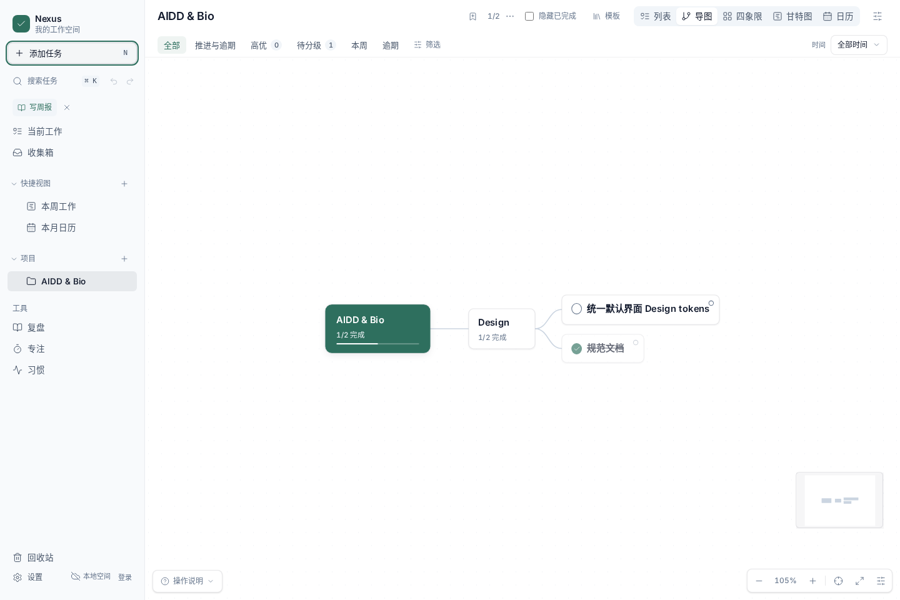
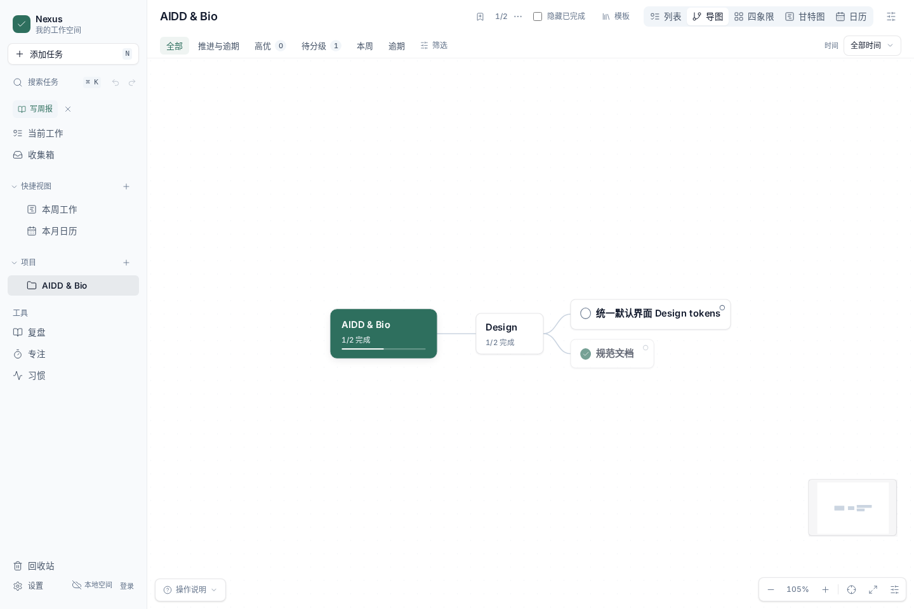
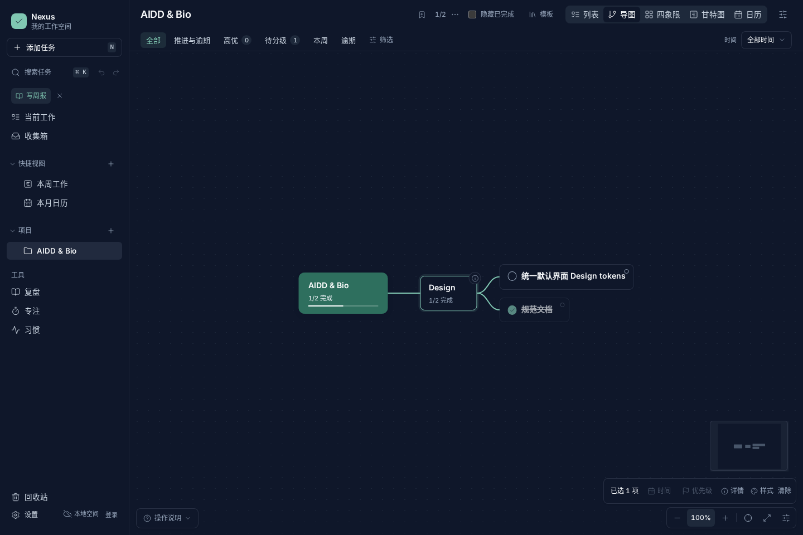
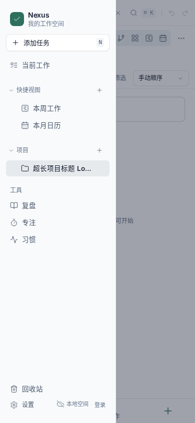

# UI 工程规范 v1.0 实施与验收

2026-11-28，任务：[应用 Gemini 设计的 UI 基础风格](http://115.190.3.4:30090/tasks?focusTask=p6_d5QTOtI2x)。

## 实施范围

按 [改版手册](../UI_REFACTOR_PLAYBOOK.md) 的 P0 → P1 → P2 顺序完成：

- P0：新增共享语义 Token；默认 Slate + 森林绿，石墨为可选规范主题；旧主题兼容映射。清除业务组件字面颜色／自定义阴影，统一排版、数字、圆角、焦点和禁用状态；日程种类不再引入额外强调色。
- P1：工作空间名称、搜索和撤销入口移到侧栏；默认侧栏 232px（范围 220–240px），添加按钮 34px，导航 32px；桌面工作区主行 52px、筛选行 40px；分段器 32px，外圆角 8px、内圆角 6px、内边距 2px。窄桌面次要操作进入更多菜单，筛选横向滚动。
- P2：默认节点 14px/600；纯白子节点与轻投影、森林绿根节点与双层阴影、2px 微型进度条；1.5px Slate 连接线采用水平三次贝塞尔，关联节点选中／悬停为 2px 强调线；20px / 1px 点阵在缩放小于 0.5 时淡出。选择与悬停不改变节点尺寸或触发布局重测。

用户已有节点字体／颜色／字号、习惯颜色、直线／折线配置保持有效。五种任务视图、移动端安全区／手势、账号隔离、数据同步保持原有行为。规范冲突及兼容边界集中记录于 [UI_ENGINEERING_SPEC.md](../UI_ENGINEERING_SPEC.md)。

## 验证

| 检查 | 结果 |
| --- | --- |
| `pnpm lint:ui` | 通过；业务源码无字面色板、自定义阴影、非网格任意间距、超 180ms 控件动效 |
| `pnpm typecheck` | 全仓通过 |
| `pnpm build` | Web／Server 通过；保留既有 bundle size 提示 |
| `pnpm test`（先构建 Agent host） | 456 通过，2 按原配置跳过 |
| Chromium 定向回归 | 98 通过，覆盖 14 个测试文件 |
| 窄屏细节与视觉规格复验 | 12 通过（移动工具栏、筛选和 4 项视觉规格），，包含实际 CSS 几何、明暗主题、曲线控制点、低缩放点阵、键盘焦点／禁用、主题迁移和对比度 |
| 数据压力 | 1001 个任务计数显示 999+，长中英混合标题截断、空项目、200 节点选择无全图测量；320/360/390px 移动布局 |
| WebKit／Safari | 本机浏览器下载未完成，未宣称通过；CI 保留 WebKit 矩阵，真机 Safari 未验证 |

首轮服务测试因未先生成 `agent-host.cjs` 失败；构建后重跑全部通过。CI 已调整为先构建再测试。旧视觉断言同步更新为新规范，行为断言继续保留。

所有回归均使用 `e2e/server.mjs` 创建的临时数据目录和独立服务，未向生产创建账号／任务。生产发布按 RUNBOOK 保留旧镜像、停服备份完整 data、替换容器后只读检查；具体镜像、备份和上线结果写入该 Task 的执行报告。

## PR 视觉审查

- [x] Token：新增语义值集中于共享 Token 文件，CI 检查业务源码。
- [x] 对比度与数字：核心正文、导航、辅助说明、徽章／快捷键和主按钮的语义前景背景组合 ≥ 4.5:1；全站数字启用 tabular-nums。警告／成功可读文字独立于状态填充色。
- [x] 分割线：桌面主行无底边，仅筛选行与画布分隔；静态任务行不增加阴影或多余横线。
- [x] 圆角：分段器 8 = 6 + 2；菜单／Select 10 = 6 + 4；共享按钮和输入框采用 8px。
- [x] 状态：共享控件、侧栏和筛选使用 Hover、Pressed、Selected、Focus-visible、Disabled；颜色 120ms，位移 180ms，减少动态效果立即切换。
- [x] 极端内容：长标题、空状态、999+ 计数和手机宽度已验证。

## 截图

截图使用独立实例中的虚构数据，覆盖浅色／深色、列表／导图和移动侧栏。与具体业务功能有关的长期视觉检查仍应随 PR diff 人工复核，静态 lint 不替代可访问性与实际页面验收。

